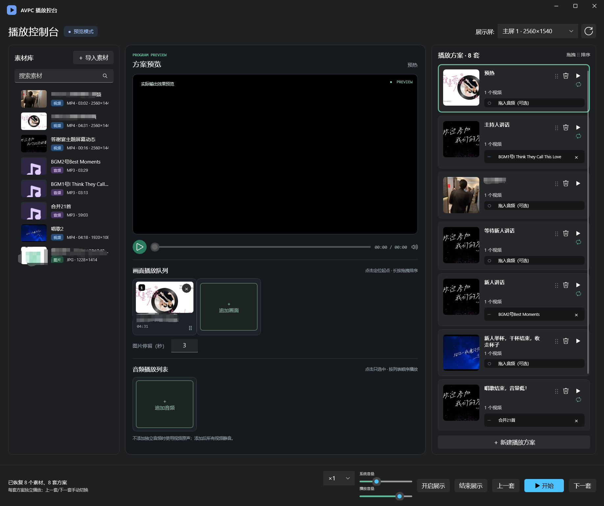

# AVPC 音视频播放控台

基于 C#、.NET 8 和 WinUI 3 的 Windows 11 双屏多媒体播放控台。主控台使用 Mica 材质，正式内容通过独立窗口在指定显示器无边框全屏播放。

## 界面预览



## 核心功能

- **素材管理**：多选导入视频、音频和图片，展示缩略图、媒体信息与类型标签，支持搜索和失效文件标记。
- **方案编排**：图片与视频组成同一个有序画面队列，支持拖拽替换、追加和排序；音频可组成独立播放列表。
- **灵活播放**：图片默认停留 5 秒，视频完整播放后切换；画面与音频分别循环，互不影响。
- **结束行为**：非循环队列末尾为视频时，可保持最后一帧，或在最后 2 秒淡出到黑屏。
- **双屏输出**：控制台与正式输出可分别选择显示器，媒体等比显示，不拉伸、不裁剪。
- **预览隔离**：预览不会改变正式方案索引；上一套只加载目标方案，下一套进入后立即播放。
- **独立音量**：每套方案分别保存系统音量与播放音量，切入方案时自动恢复。
- **自动保存**：素材库、方案顺序、播放队列与设置自动持久化，下次启动自动恢复。

## 环境要求

- Windows 11（推荐，用于完整 Mica 效果），x64 系统。
- 构建需要 .NET 8 SDK。
- 项目使用 Windows App SDK 2.7，并启用自包含部署。
- 视频播放依赖系统解码器；HEVC 素材需要可用的 HEVC 解码支持。

## 快速开始

日常使用直接运行：

```powershell
.\start.cmd
```

脚本会先执行增量构建，再启动最新程序。需要退出时，可关闭主控台或运行 `.\stop.cmd`。

开发模式：

```powershell
dotnet run --project src/AVPC
```

## 使用流程

1. 点击「＋ 导入素材」，选择一个或多个视频、音频或图片。
2. 点击「＋ 新建播放方案」，将素材拖到方案卡片或中间的画面长廊，配置画面与音频队列。
3. 按需设置图片停留时间、循环方式、结束行为、系统音量与播放音量。
4. 在预览区检查当前方案。预览不会影响正式播放顺序。
5. 选择正式输出显示器，点击「开启展示」，再点击「▶ 开始」从第一套方案播放。
6. 使用「上一套」「下一套」切换方案；末套之后进入全黑结束状态。
7. 点击「结束展示」停止内容并隐藏输出窗口；再次开始会从第一套重新播放。

素材库和方案保存在 `%LOCALAPPDATA%\AVPC\workspace.json`。文件丢失时会保留素材记录并标记不可用，不会静默删除方案。

## 构建与测试

```powershell
# 全部自动测试
dotnet test AVPC.sln

# 解决方案构建
dotnet build AVPC.sln

# 更新 start.cmd 实际启动的项目输出
dotnet build src/AVPC/AVPC.csproj
```

## 工程结构

| 路径 | 职责 |
| --- | --- |
| `src/AVPC.Core/` | 素材、方案、混合画面队列、音频列表与工作区序列化 |
| `src/AVPC/` | WinUI 3 主控台、预览、拖放编辑与正式播放窗口 |
| `src/AVPC/Services/` | 播放协调、显示器管理、素材导入和工作区读写 |
| `tests/AVPC.Tests/` | 核心行为自动测试 |
